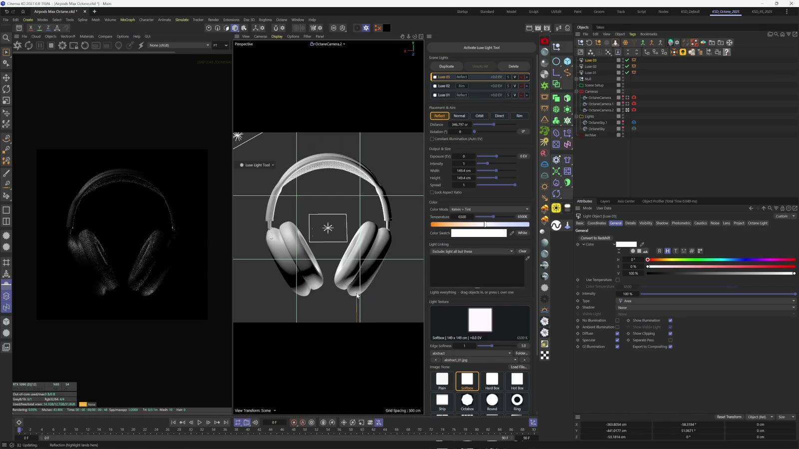

# Luxe

Place lights by clicking your model. Luxe is a Cinema 4D plugin for Redshift and Octane. Click where the light
should land, drag to slide the highlight across the surface, and shape the light from one panel in photographic
terms: EV, Kelvin, gels, size and spread. It includes built-in light textures, a gobo library, solo, and light
linking.

[](docs/media/luxe-demo.mp4)

[Watch the demo](docs/media/luxe-demo.mp4) (40 seconds, played at 3x).

## Requirements

- Cinema 4D 2027 (Python 3.11 or newer, no extra packages)
- Redshift or Octane
- Windows

Tested on Cinema 4D 2027, Redshift 2027 and Octane 2027.1 Beta. Nothing else has been tested.

## Install

1. Download and unzip the release.
2. In Cinema 4D choose **Edit > Preferences > Plugins > Add Folder** and pick the `Luxe` folder.
   Or put the `Luxe` folder in Cinema 4D's `plugins` folder.
3. Restart Cinema 4D.
4. Choose **Extensions > Luxe Light Tool**, hover a model and click to make a light.
   **Extensions > Luxe** opens the panel.

Full instructions, keys and known issues: [docs/USER_GUIDE.md](docs/USER_GUIDE.md).

## Status

Early. Octane 2027.1 Beta 1 can crash when lights change during a Live Viewer render on some multi-GPU setups. The
guide has the details.

## Licence

Luxe is source-available under the [PolyForm Small Business License 1.0.0](LICENSE). It is free for any use,
commercial included, by individuals and by companies with fewer than 100 people and less than 1,000,000 USD (2019,
adjusted for inflation) in revenue in the prior tax year. Larger companies need a commercial licence: contact
Kyle Sullivan at [kylesullivandesign.com](https://kylesullivandesign.com).

## Tests

```bash
./tools/check.sh
```

Runs the core unit tests, then compiles and lints the Cinema 4D code. The plugin itself is checked by hand in
Cinema 4D.
